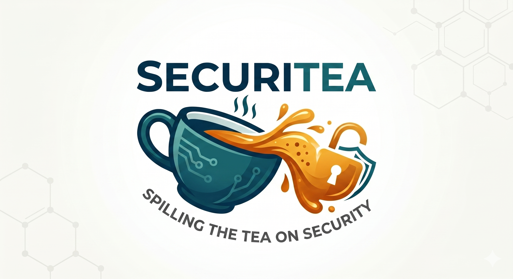

# SecuriTea
Spilling the tea about security.


SecuriTea is an open-source handheld IR tool on an ESP32-S3, built as a Flipper Zero style
remake. It reads and writes Flipper `.ir` files, so remotes from
[Flipper-IRDB](https://github.com/Lucaslhm/Flipper-IRDB) work unchanged.

Features:
- Universal remote: send every "Power" (or any other group) across a profile of many brands
- File browser: open any `.ir` file on the SD card, send one command, loop all of them, or delete one
- Learn mode: capture a signal from a real remote and append it to `/captures/learned.ir`
- 128x64 OLED and joystick interface, screen sleeps after 3 min idle

## Hardware

- Heltec WiFi LoRa 32 V3 (ESP32-S3, onboard SSD1306 OLED and SX1262 radio)
- IR receiver module (Learn mode) and IR LED with a driver transistor
- Analog joystick with push button
- Micro SD card module on SPI

All pin assignments live in `board_config.h`:

| Function          | GPIO | Notes                              |
|-------------------|------|------------------------------------|
| Joystick X        | 3    | ADC                                |
| Joystick Y        | 4    | ADC                                |
| Joystick button   | 5    | to GND, internal pull-up           |
| IR receiver       | 6    |                                    |
| IR LED            | 7    |                                    |
| SD SCK / MISO / MOSI | 33 / 34 / 47 | external SPI bus (FSPI)   |
| SD CS             | 48   |                                    |
| OLED SDA / SCL / RST | 17 / 18 / 21 | fixed by the board         |
| PN532 NFC CS / IRQ / RST | 38 / 39 / 40 | reserved, not wired yet |

## Project structure

| File | Contents |
|------|----------|
| `securitea.ino` | globals, `setup()`, task creation |
| `app_state.h` | shared types, limits, tunables |
| `board_config.h` | every pin and bus assignment |
| `ir_file.h/.cpp` | Flipper `.ir` parser and validation (no globals) |
| `storage.h/.cpp` | everything that touches the SD card: bus, lock, mount, index, safe delete |
| `ir_engine.h/.cpp` | the IR hardware: LED driver, receiver, protocol frames |
| `ui.h/.cpp` | the screens, drawn from a `UiModel` |
| `input.h/.cpp` | the joystick |
| `app.h`, `launcher.cpp` | the `App` interface and the launcher that runs the current app |
| `ir_app.h/.cpp` | the infrared app: menus, browser, remote view, learn (all its state is inside) |
| `app_glue.h`, `storage_ir.ino` | what apps may call in the sketch; storage and IR results turned into status text |
| `tasks.ino` | `uiTask` (drives the current app) and `irTask` (send, delete, learn jobs) |
| `helpers.ino` | shared-state setters, cancel counter, queue helpers, diagnostics |
| `ui_layout.h/.cpp` | OLED drawing primitives |

Two FreeRTOS tasks run on separate cores. The UI task owns the screen and every UI variable.
The IR task owns the LED and receiver. They communicate only through two queues: commands go
UI to IR and carry everything the job needs (file path, command index, timing); results come
back IR to UI. One task owns each piece of data.

## SD card layout

```
/univ_tv.ir, /univ_ac.ir, /univ_proj.ir, /univ_audio.ir   universal profiles
/captures/learned.ir                                       learned commands (created on first save)
/<anything>/*.ir                                           browse and send (Flipper-IRDB layout works)
```

A universal profile is an ordinary `.ir` file whose command names are the group names
("Power", "Vol+", ...). Every command named "Power" is sent in turn when you pick Power.

## `.ir` file format

```
name: Power
type: raw
frequency: 38000
duty_cycle: 0.33
data: 9000 4500 560 560 560 1690 ...

name: Mute
type: parsed
protocol: NEC
address: 04 00 00 00
command: 08 00 00 00
```

Raw signals are validated on load: no mark or space may be 0, a value above 65535 us is
shortened to 65535 us (the longest the sender can time), the whole signal must be at most 4 s
and at most 500 values, and the carrier between 10 and 56 kHz. Parsed
protocols supported for sending: NEC, NECext, Samsung32, RC5, RC6, SIRC. Files are capped at
1000 commands.

## Controls

| Screen | Up / Down | Right | Left | Button |
|--------|-----------|-------|------|--------|
| Menus | move | | back | select |
| Universal remote | pick group | select mode badge | back / cancel | send group (or toggle Single / Aggressive) |
| File browser | move | cycle A-Z filter | clear filter, then back | open |
| Remote view | previous / next command | select mode badge | back (stops a loop) | send, loop all, or delete (press twice) |
| Learn | | | back | save capture / listen again |

## Build and flash

Board, core and library versions are pinned in `sketch.yaml`.

```
arduino-cli compile --build-path build .
arduino-cli upload -p /dev/cu.usbserial-0001 --fqbn esp32:esp32:heltec_wifi_lora_32_V3 --input-dir build .
```

Or open the folder in the Arduino IDE, choose "Heltec WiFi LoRa 32 (V3)" and upload.
Serial at 115200 prints the reset reason at boot and heap and stack headroom every 5 s.

## Responsible use

Only send IR to equipment you own or are allowed to control. The universal profiles can
switch off displays in public places; that is someone else's property.

## Tests and continuous integration

- `make -C tests/host` builds and runs the `.ir` parser tests on your computer, under
  AddressSanitizer and UndefinedBehaviorSanitizer. No board needed. The tests cover the bounded
  line reader, raw and parsed commands, the validation limits, the copy routine used by delete,
  and a fuzzer that feeds the parser random input.
- GitHub Actions (`.github/workflows/ci.yml`) runs on every push: the firmware build with the
  pinned core and library versions from `sketch.yaml` (zero warnings allowed in project files,
  binaries kept as an artifact), the host tests, and cppcheck.

## License

MIT, see `LICENSE`.
